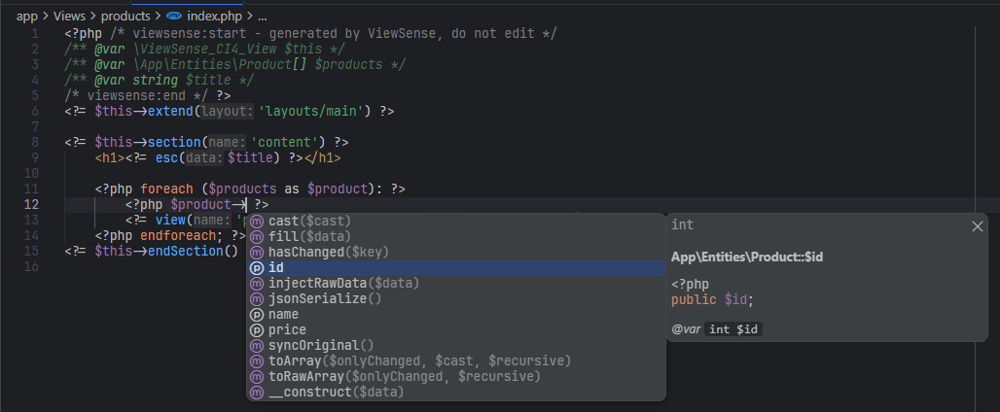

# ViewSense for CodeIgniter

Your editor knows the variables your controllers pass to your CodeIgniter 3 and 4 views, and
their types. No more hand-written `/** @var */` comments, no more "undefined variable" warnings.

> **Preview:** this is the first public version. Feedback and bug reports are welcome on
> [GitHub](https://github.com/Ezar101/viewsense-codeigniter/issues).

## The problem

A CodeIgniter view gets its variables from a controller:

```php
// application/controllers/Products.php
$data['title'] = 'All products';
$data['products'] = $this->products->get_all(); // @return Product[]
$this->load->view('products/list', $data);
```

Inside `application/views/products/list.php`, your editor doesn't know that `$title` or
`$products` exist. You get warnings and no autocompletion.

## What ViewSense does

It reads your controllers and writes this block at the top of the view:

```php
<?php /* viewsense:start - generated by ViewSense, do not edit */
/** @var \ViewSense_CI3_View $this */
/** @var \Product[] $products */
/** @var string $title */
/* viewsense:end */ ?>
<h1><?= html_escape($title) ?></h1>
```



Your PHP extension ([Intelephense](https://marketplace.visualstudio.com/items?itemName=bmewburn.vscode-intelephense-client),
[PHP Tools](https://marketplace.visualstudio.com/items?itemName=DEVSENSE.phptools-vscode),
Phpactor...) reads these lines: you get autocompletion, hover and go to definition on
`$products`, and the warnings go away. ViewSense works alongside it and never changes anything
outside the two markers.

## Features

- **CodeIgniter 3:** `$this->load->view()`, `$this->load->vars()`, models and libraries loaded with
  `$this->load->model()` and `$this->load->library()`, and `$this` in views.
- **CodeIgniter 4:** `view()`, the renderer service (`setVar()`, `setData()`, `render()`),
  `$this->include()`, `model()`, model `$returnType`, and `$this` in views.
- **Types** from literals, `new`, parameters, local variables, typed properties, `@property`,
  `@var`, `@return`, `@method` and native return types. Unknown types become `mixed`.
- **One view, several controllers:** the types are merged, e.g. `string|null`.
- **Partial views** get the variables of the view that includes them, and `foreach` items get
  the type of the array items.
- **Your own render methods and helpers**, such as `$this->render('products/form', $data)`, with
  a small `.viewsense.json` file.
- **Always up to date:** the blocks are updated when you save a PHP file.

## Usage

1. Open a CodeIgniter 3 or 4 project folder.
2. Save a controller, or run **ViewSense: Update View Hints** from the Command Palette
   (`Ctrl+Shift+P`).

When you open a project, ViewSense only checks the blocks and shows a warning on views that are
out of date. It never changes a file on its own at startup.

The details of each run are in the **ViewSense** output channel.

### `$this` in views

ViewSense describes `$this` with a class it generates in the `.viewsense/` folder. The folder
holds its own `.gitignore`, so Git ignores it.

- **CodeIgniter 4:** `ViewSense_CI4_View` extends `CodeIgniter\View\View`, the view renderer.
  It lets you write `<?= $this->extend('layout') ?>` as in the CodeIgniter docs, without a
  "void" warning from your PHP extension.
- **CodeIgniter 3:** `ViewSense_CI3_View` extends `CI_Loader` and lists what your controllers
  can reach: `$this->input`, loaded models and libraries, controller properties.

Class names in the generated blocks start with a backslash (`\Product`), so tools such as PHP
Namespace Resolver don't report them as "not imported".

## Settings

| Setting                  | Default | Description                                                                                                                                                                       |
| ------------------------ | ------- | --------------------------------------------------------------------------------------------------------------------------------------------------------------------------------- |
| `viewsense.updateOnSave` | `true`  | Update the blocks when you save a PHP file or `.viewsense.json`. When off, ViewSense only shows a warning on out-of-date views, with a quick fix (`Ctrl+.`) that runs the update. |

## Configuration

ViewSense works without configuration. To tell it about your own render methods and helpers, add
a `.viewsense.json` file at the project root:

```json
{
  "viewCalls": [
    { "method": "render", "view": 0, "data": 1, "layout": "layouts/main" },
    { "function": "include_view" }
  ]
}
```

You get completion and checks in this file as you type. See the
[configuration reference](https://github.com/Ezar101/viewsense-codeigniter/blob/main/docs/configuration.md)
for every setting, including custom folder names.

## Requirements

- VS Code 1.101 or later (or an editor based on it, such as VSCodium or Cursor).
- A PHP extension that reads PHPDoc, such as Intelephense or PHP Tools.
- A project folder on disk: virtual workspaces aren't supported.

## Known limitations

- ViewSense only follows calls whose view name is a plain string, such as `'products/list'`.
- A method that passes its own `$data` parameter to a layout needs a `layout` entry in
  `.viewsense.json`.
- CodeIgniter 3 `config/autoload.php` isn't read yet.

## License

[MIT](https://github.com/Ezar101/viewsense-codeigniter/blob/main/LICENSE)
